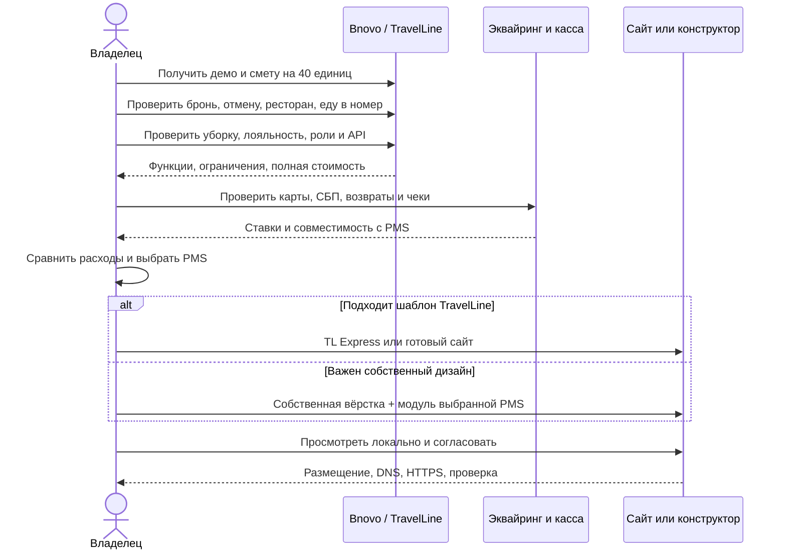
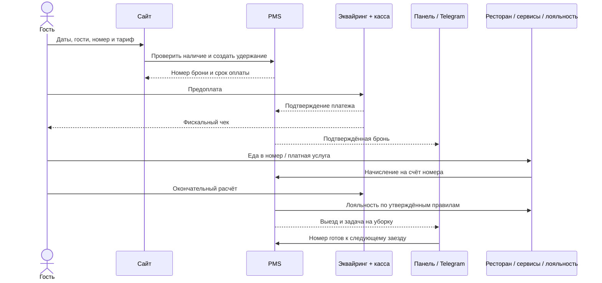

# База отдыха: сайт, бронирование и экономика запуска

Для вашего объекта я бы сохранил **собственный сайт и готовую гостиничную PMS**, а выбор между Bnovo и TravelLine сделал после одинакового теста демоверсий. Самый быстрый вариант реального запуска — конструктор TravelLine, если устроят его шаблоны. Полностью своё ядро бронирования оправдано, когда подтверждённые ограничения готовых систем стоят бизнесу больше, чем разработка и сопровождение.

Расчёты ниже — для Москвы (город), **30 номеров и 10 отдельно сдаваемых домов**. Проверка публичных условий — **5 ноября 2026 года**. Цена поставщика, арифметический расчёт и условный бюджет обозначены отдельно. Демо пока изучены по публичным материалам; входа в аккаунты и реальных тестовых броней не было.

## Прототип сайта и публикация

Репозиторий: [IDyushin/hotel-retreat](https://github.com/IDyushin/hotel-retreat).

Сайт: [hotel.168-231-101-178.sslip.io](https://hotel.168-231-101-178.sslip.io/).

В прототипе 18 основных страниц: главная, каталог и три категории, выбор дат и гостей, фильтры, фотографии, примерные тарифы и отдельные страницы-заглушки. Мобильная версия намеренно не разработана. Реальные брони, оплата и отправка персональных данных не подключены. Данные, фотографии и цены демонстрационные.

Размещение подготовлено под существующую схему владельца: приватный GitHub-репозиторий → общий workflow server-kit → отдельный статический сайт на сервере. Первая публикация выполняется вручную через существующее SSH-подключение; автоматическая ожидает разрешения на настройку секретов нового репозитория. Бесплатный адрес sslip.io содержит IP сервера и меняется при переезде. [sslip.io](https://sslip.io/). Другой вариант бесплатного поддомена — [DuckDNS](https://www.duckdns.org/faqs.jsp); это не собственный домен второго уровня.

## Выбор гостиничного ядра и CRM

Для 40 объектов нужна PMS: календарь доступности по ночам, тарифы, брони, гости, оплаты и отмены. База гостей обычно уже входит, поэтому отдельная CRM на старте необязательна. При продажах на нескольких площадках нужен channel manager — синхронизация доступности и тарифов.

### Собственная система

Свою панель и интеграцию разумно добавить поверх готовой PMS. Полностью своё ядро требует защиты от пересечений, удержаний до оплаты, отмен, возвратов, ролей сотрудников, аудита и синхронизации каналов. Простая форма → Telegram является заявкой с ручным подтверждением, а не автоматическим бронированием. Стоимость собственного ядра без отдельного технического задания достоверно не определена.

### YCLIENTS

Публичная цена — от 1 600 ₽/мес.; это рекламный минимум, не смета на 40 номеров. По официальной инструкции многодневные записи ограничены семью сутками и создаются вручную, через онлайн-запись они недоступны. Поэтому как гостиничное ядро сервис не выбран; отдельно для SPA, массажа и услуг по времени его можно рассматривать. [Тарифный ориентир](https://www.yclients.ru/entertainment), [ограничения многодневной записи](https://support.yclients.ru/981).

## Bnovo, TravelLine и дополнительные услуги

У **Bnovo** подтверждены PMS и модуль, встраиваемый в собственный сайт. Актуального собственного конструктора с открытым тарифом в исследованном каталоге не найдено; обещать его наличие или бесплатный сайт нельзя. Для нового расширенного запроса прежний «Старт» уже не покрывает весь набор функций. [Каталог Bnovo](https://bnovo.ru/).

| Bnovo, фонд 40 единиц | При оплате 12 периодов | Что существенно для вас |
|---|---:|---|
| «Старт» | 9 600 ₽ за период; аванс 115 200 ₽ | Размещение, модуль сайта, база гостей, 6 каналов |
| «Рост» | 12 800 ₽; аванс 153 600 ₽ | Встроенная уборка, дополнительные интеграции, включая iiko |
| «Максимум» | 14 400 ₽; аванс 172 800 ₽ **+ 1%** завершённых броней модуля | Лояльность и двусторонний API |

Это цены при соответствующей предоплате, а не возможность ежемесячно платить указанную сумму. Важная поправка к предыдущему ответу: по оферте период равен **30 дням**, следовательно, пакет из 12 периодов — **360 дней**. Внешние ресторанные лицензии и услуги интегратора не становятся бесплатными. [Тарифы](https://bnovo.ru/tarif/), [оферта](https://bnovo.ru/offer-application/).

У **TravelLine есть конструктор TL:Express — 2 000 ₽/месяц + 4% бронирований сайта**, хостинг включён. PMS, каналы продаж и дополнительные сервисы оплачиваются отдельно. Собственный домен подключается, но его бесплатное продление не обещано. Это хороший кандидат для быстрого запуска без самостоятельного обслуживания сайта; соответствие шаблонов вашему референсу проверяем в демо. [TL:Express](https://www.travelline.ru/products/tl-express/).

Другая услуга TravelLine — разработка сайта **от 87 000 ₽ разово** либо предложение разработки с сопровождением **от 14 000 ₽/месяц**. Это отдельные предложения, их не следует автоматически складывать. В общем прайсе ещё встречается 79 000 ₽, поэтому для бюджета беру более высокую цифру со страницы продукта; окончательно нужны состав работ и письменное предложение. [Разработка сайта](https://www.travelline.ru/products/tl-site/), [общий прайс](https://www.travelline.ru/price/).

Каталог интеграций Bnovo полезен, если отбирать решения по конкретной задаче: ресторан, уборка, касса, бухгалтерия, замки, сообщения. Количество логотипов само по себе не показывает стоимость и готовность процесса. [Интеграции Bnovo](https://bnovo.ru/integration/).

**Ресторан и заказ еды в номер — разные процессы.** Для Bnovo+iiko нужны работающая iiko, касса и платный модуль PMSIntegration на стороне ресторанной системы. TravelLine поддерживает iiko/r_keeper в Premium; витрина заказов и обслуживание гостя через Hotbot требуют отдельного договора. В демо нужно показать путь от заказа до счёта номера, оплаты и возврата. [Bnovo+iiko](https://help.bnovo.ru/knowledgebase/интеграция-с-iiko/), [модули TravelLine](https://www.travelline.ru/products/webpms/modules/), [Hotbot](https://www.travelline.ru/support/knowledge-base/kak-rabotat-s-servisom-hotbot-ai-v-tl-webpms/).

## Порог меньших расходов между системами

Порог здесь означает меньшие расходы на сопоставимую систему, а не окупаемость отеля. Обозначим **R** полной стоимостью состоявшихся броней именно с сайта, **P** — суммой фактически проведённых платежей. При предоплате 30% эти базы различаются. TravelLine берёт 4% с полной суммы соответствующей брони; банковская комиссия считается с платежа. [Прайс TravelLine](https://www.travelline.ru/price/).

Для расширенного набора функций используем Bnovo «Максимум». Приведение его фиксированной платы к среднему календарному месяцу: `14 400 × 365 / 30 / 12 = 14 600 ₽`. Это экономический эквивалент, фактическая оплата пакетная. Тогда:

`Bnovo ≈ 14 600 + 1% × R`

`TravelLine = F + 4% × R`

Здесь **F — вся фиксированная часть сопоставимого комплекта TravelLine**. Единая публичная цена для 40 единиц с рестораном, лояльностью и нужными интеграциями не подтверждена. Поэтому таблица ниже — чувствительность модели, а не тарифное предложение:

| Условное F в месяц | Порог R: выше него Bnovo дешевле по этим статьям |
|---:|---:|
| 4 000 ₽ | около 353 тыс. ₽ |
| 7 000 ₽ | около 253 тыс. ₽ |
| 10 000 ₽ | около 153 тыс. ₽ |

При **условном F = 7 000 ₽** и R = 900 000 ₽ получаем **23 600 ₽ Bnovo против 43 000 ₽ TravelLine**. При R = 1,8 млн ₽ — **32 600 против 79 000 ₽**. Эквайринг, шлюзы, ресторанное ПО и платные партнёры здесь отдельно. Если в частном сценарии только Bnovo добавляет шлюз 0,5%, вся сумма оплачена онлайн, а банковские ставки одинаковы, порог сдвигается с 253 до **304 тыс. ₽**. У TravelLine свои платёжные опции тоже могут иметь отдельную комиссию. Более высокая стоимость системы также может оправдываться продажами и экономией труда, но данных для оценки такого эффекта пока нет.

У **1С:Отель** официально 79 000 ₽ за основную поставку и 199 000 ₽ за комплект на пять пользователей; это рабочие места персонала. Внедрение, сопровождение, онлайн-продажи и дополнительные лицензии считаются отдельно. [Каталог 1С](https://solutions.1c.ru/catalog/hotel/buy), [состав лицензий](https://solutions.1c.ru/news/985386/).

Честная формула возврата дополнительных вложений: `дополнительные стартовые затраты / ежемесячная экономия`. Например, **если** полный вариант 1С дороже при запуске на 250 000 ₽ и экономит 10 000 ₽ ежемесячно после всех расходов, срок — **25 месяцев**. Обе суммы условные. Деление одной лицензии на подписку облачной PMS не даёт достоверной окупаемости.

## Интернет-эквайринг

| Пример | Опубликованные условия | Расход на 1 млн ₽ платежей |
|---|---|---:|
| Точка, интернет-эквайринг для туризма | **от 2% с НДС** | от 20 000 ₽ |
| СБП для гостиницы | 0,7% | 7 000 ₽* |
| ЮKassa, базовый карточный тариф услуг | 3,5% без НДС; денежное удержание с НДС на комиссию **4,27%** | 42 700 ₽ |

*Расчёт без влияния предельной комиссии на крупные отдельные переводы. Банковские ставки «от» требуют подтверждения для вашего оборота и деятельности. [Точка](https://tochka.com/acquiring/), [ПСБ о СБП для гостиниц](https://www.psbank.ru/corporate/cards/sbp), [ЮKassa](https://yookassa.ru/docs/support/payments/fees).

Пример: 70% платежей картой по 2% и 30% через СБП по 0,7% дают **1,61%**, то есть **14 490 ₽ с 900 000 ₽ платежей**. Если использовать шлюз Bnovo с комиссией 0,5%, он добавит **4 500 ₽** с той же суммы. Итого платежи — 18 990 ₽, отдельно от PMS. Поддержку выбранного банка и возвратов проверяем до договора. [Шлюз Bnovo](https://bnovo.pro/paymentgateway).

Онлайн-касса, ОФД и накопитель — отдельная статья. Предоплату и последующий полный расчёт нужно фискализировать по применимым правилам; Telegram-уведомление чек не заменяет. Полный актуальный комплект кассы по рекламной минимальной цене не подтверждён, поэтому в сумму его не подставляю. [ФНС о зачёте предоплаты](https://www.nalog.gov.ru/rn50/news/activities_fts/14798229/).

## Налоги ИП в 2026 году: Москва

Базовые варианты УСН — **6% доходов** либо **15% доходов минус признанные расходы**; возможны региональные условия и пониженные ставки. Для второго варианта действует минимальный годовой налог 1% доходов. Математическая граница без вычетов: при расходах 60% выручки оба варианта дают одинаковую сумму. Взносы, льготы и состав признанных расходов меняют результат. [ФНС об УСН](https://www.nalog.gov.ru/rn77/taxation/taxes/usn/).

При условной выручке 36 млн ₽ в год 6% — 2,16 млн ₽ до уменьшений. Если признанные расходы составляют 24 млн ₽, 15% от разницы — 1,8 млн ₽. Это сравнение баз, а не окончательный налоговый расчёт.

В 2026 году порог освобождения УСН от НДС — **20 млн ₽**. Поэтому при выручке 3 млн ₽ в месяц вопрос НДС возникает практически. Для соответствующих услуг размещения возможно 0% при выборе общих ставок и выполнении условий; ресторан и SPA автоматически эту ставку не получают. Специальные ставки 5/7% имеют другой порядок. [ФНС: НДС при УСН](https://www.nalog.gov.ru/rn77/taxation/taxes/nds_usn/).

Взносы ИП за себя в 2026 году — **57 390 ₽ плюс 1% базы свыше 300 000 ₽**, дополнительный взнос ограничен **321 818 ₽**. Взносы персонала считаются отдельно; УСН «доходы» при соблюдении правил уменьшается на взносы, поэтому механически складывать все суммы нельзя. [ФНС: суммы взносов](https://www.nalog.gov.ru/rn25/ifns/r25_16/info/16603713/), [уменьшение УСН](https://www.nalog.gov.ru/rn70/news/seminar/16620047/).

Для **города Москвы** в 2026 году туристический налог не введён по опубликованному разъяснению ФНС. Поэтому московский расчёт его не включает. Это уточнение относится к Москве, а не к Московской области. [ФНС Москвы](https://www.nalog.gov.ru/rn77/news/activities_fts/16614751/).

В Москве существует льготная ставка УСН 10% для отдельных отраслей с требованием к доле соответствующей выручки; обычное гостиничное размещение в перечне закона № 41 не указано. Без отдельного основания для гостиницы используем базовое сравнение 6%/15%. Для ИП также важно место его налогового учёта. [Московский закон № 41 на сайте ФНС](https://data.nalog.ru/html/sites/www.rn77.nalog.ru/2026/4kv2026/ZakongMoskviot07102009N41.pdf).

## Свой сайт, инфраструктура и Telegram

Проверяемый небольшой пример: VPS FirstVDS 1 CPU/2 ГБ/40 ГБ SSD с IPv4 — **519 ₽/месяц**, отдельный backup-диск 30 ГБ — **150 ₽**. Домен .ru у Timeweb — **200 ₽ первый год, продление 399 ₽**. Итого **8 228 ₽ первый год, 8 427 ₽ следующий**, без труда, PMS, кассы и платежей. На уже оплаченном подходящем сервере дополнительная аренда может быть нулевой. [FirstVDS](https://firstvds.ru/docs/tariffs.html), [домены Timeweb](https://timeweb.com/ru/services/domains/).

TLS Let’s Encrypt и обычные уведомления Telegram не требуют платы за лицензию. Но FirstVDS предупреждает о недоступности Telegram API с московских серверов: доступность надо проверить именно на вашем сервере, предусмотрев панель/email как резерв. [Let’s Encrypt](https://letsencrypt.org/about/), [Telegram](https://core.telegram.org/bots/faq), [FAQ FirstVDS](https://firstvds.ru/).

Для разработки можно задать бюджет по часам, **не выдавая его за рыночную котировку**. При условных 2 000 ₽/час рабочий многостраничный сайт с мобильной версией, контентом, готовым модулем PMS и запуском: резерв 80–160 часов, **160–320 тыс. ₽**. Адаптер Telegram и простая собственная панель: ещё 24–80 часов, **48–160 тыс. ₽**. Это инженерное допущение; текущий прототип не означает выставленный вам счёт. При самостоятельной работе денежная оплата подрядчику может отсутствовать, но остаются время и обслуживание. Полностью своё гостиничное ядро без ТЗ надёжно не оценить.

## Пример эксплуатационных расходов

Все параметры этого абзаца условные: 40 единиц × 30 дней × загрузка 50% = 600 занятых единице-ночей; средняя выручка 5 000 ₽ даёт 3 млн ₽ проживания. Средний заезд на три ночи — около 200 выездных уборок. При выбранных 500 ₽ за уборку — **100 000 ₽**; 400 промежуточных уборок по 200 ₽ добавляют **80 000 ₽**. Это не найденные тарифы клининга. Домики и номера лучше считать по разным нормам, отдельно выяснив бельё и расходники.

Ведение PMS сверх обычных обязанностей ресепшен: условные 0,5 часа в день × 30 × 500 ₽/час = **7 500 ₽**. Это не зарплата полноценного администратора. При 30% продаж с сайта R = 900 тыс. ₽ и полной онлайн-оплате выбранные статьи Bnovo составят: PMS 23 600 ₽, эквайринг 14 490 ₽, шлюз 4 500 ₽, уборка 100 000 ₽, работа с PMS 7 500 ₽, инфраструктура около 702 ₽ — всего **около 151 тыс. ₽**, либо 231 тыс. ₽ с промежуточной уборкой. Это лишь перечисленные статьи: налоги, штат ресепшен, POS/ресторан, касса, коммунальные услуги, аренда, питание, ремонт, маркетинг и OTA сюда не входят. Прибыль отеля по этому числу определить нельзя.

## Диаграмма выбора и запуска

Диаграммы показывают целевую схему, которую необходимо подтвердить возможностями выбранных продуктов. На демо важно также проверить попытку одновременно продать последний номер, перенос, частичный возврат, отложенный платёж, работу прав сотрудников и выгрузку в бухгалтерию. У каждого элемента фиксируем: встроено, платный партнёр или собственная разработка. [Демо Bnovo](https://bnovo.ru/demo/), [демо TravelLine](https://www.travelline.ru/get-demo/).

### Окупается ли собственный сайт экономией на конструкторе

Если условная разработка стоит 160 000 ₽, а собственная инфраструктура — около 702 ₽/мес., экономия относительно конструктора за 2 000 ₽/мес. составит около 1 298 ₽. Окупаемость только этой экономией — примерно 123 месяца, ещё без собственной поддержки. Это модель, не коммерческое предложение: самостоятельный сайт выбирают прежде всего ради дизайна, возможностей и контроля. Комиссия оператора бронирования не исчезает от самостоятельной вёрстки.

### Как сравнить демоверсии

- Создать 40 единиц и три демонстрационные категории; настроить питание и тарифы.
- Проверить бронь на несколько ночей, частичную предоплату и одновременную продажу последнего номера.
- Перенести и отменить бронь, провести частичный возврат и проверить чеки.
- Провести ресторанный счёт на номер; отдельно заказать еду из гостевой витрины.
- Забронировать почасовую услугу, начислить и списать лояльность.
- Провести выезд, назначить уборку и проверить готовность номера.
- Проверить роли, журнал изменений, выгрузку в бухгалтерию, события API и уведомление владельцу.
- Для каждой функции записать: встроено / платный партнёр / своя разработка, разовый платёж, подписка, процент и база начисления.

Это сценарий будущего тестирования. Демо Bnovo и TravelLine в ходе исследования не регистрировались; реальных тестовых броней в них не проводилось.

## Рекомендация и что ещё подтвердить

Моя предварительная рекомендация: **свой сайт оставить для дизайна, Bnovo «Максимум» и TravelLine с нужными модулями сравнить в демо**, а TL:Express рассматривать как быстрый запуск при приемлемом шаблоне. Неопределёнными остаются полная смета TravelLine, лицензии ресторанного ПО/Hotbot, поддержка API нужного сценария, договор эквайринга, налоговый статус предпринимателя и окончательные условия подключения. Эти данные нужны до окончательного выбора и публикации, но не мешают уже сейчас оценить прототип.
